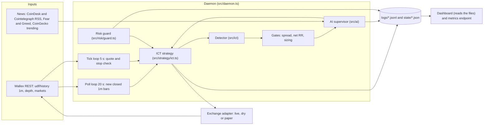
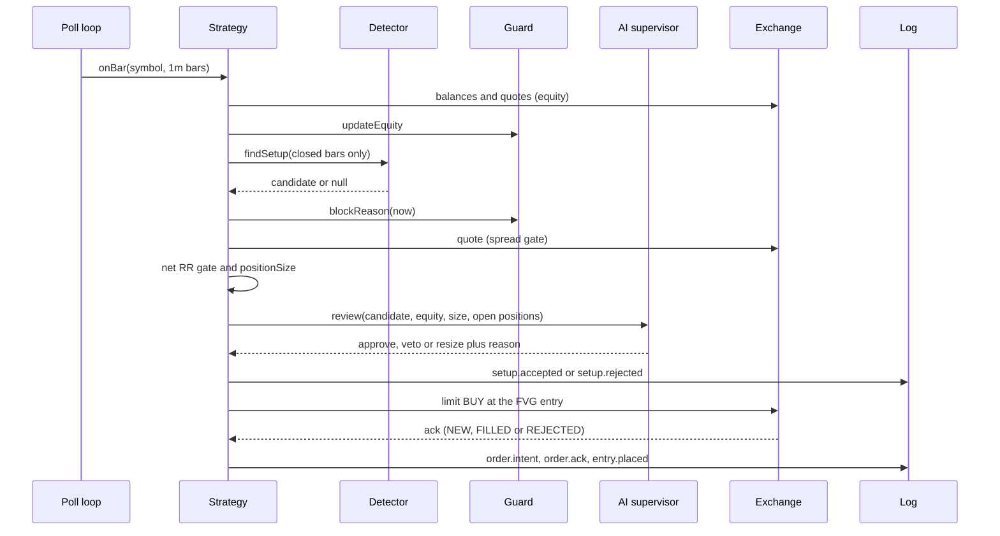
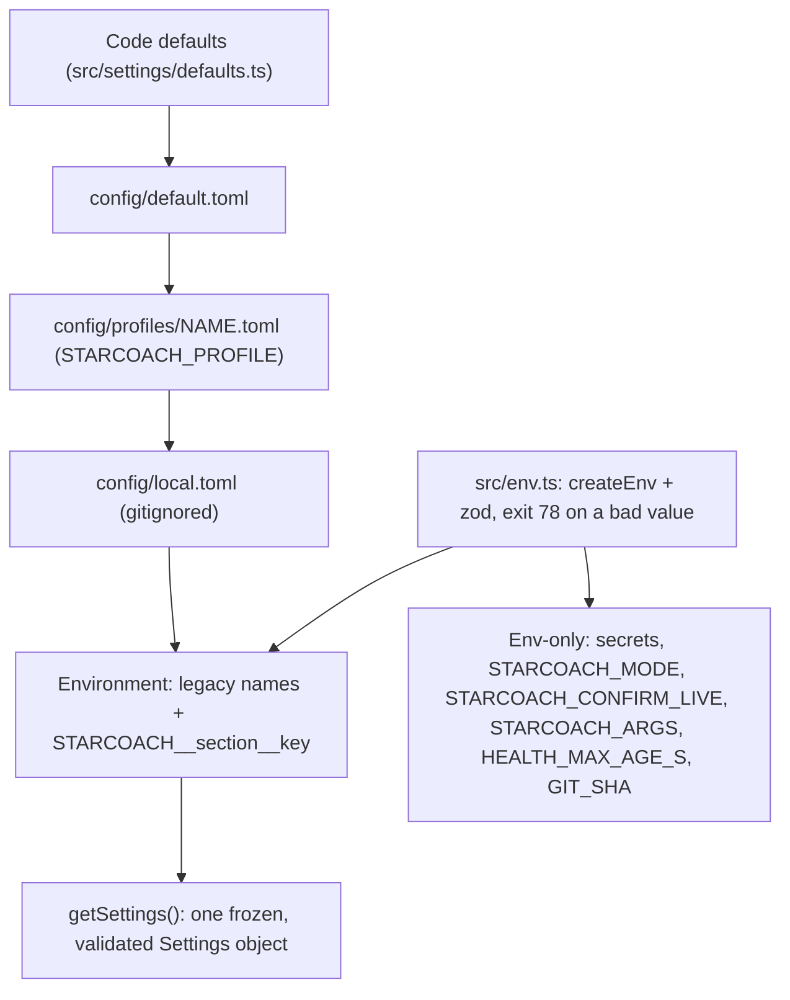

# Architecture

One Bun process. One strategy object. One `Exchange` interface with three adapters (live, dry, paper), so the strategy code is identical in every mode.

## Components

## One decision, in order

After the fill the strategy places TP1 and TP2 limit sells. The stop is watched by code, not placed on the exchange (see Failure handling).

## Module map

| Folder / file | Responsibility |
|---|---|
| `src/cli.ts` | Commands `check backtest shadow dry live pullout`, flag parsing |
| `src/daemon.ts` | Run loop, schedule (cutoff, flatten), state resume, guarded exchange, degraded alarm |
| `src/strategy/ict.ts` | Setup to order lifecycle: gates, sizing, entry, TPs, stop monitor, exits |
| `src/ict/` | `primitives.ts` (swings, FVG, displacement, levels), `detect.ts` (`findSetup`), `scan.ts` (setup counting tool), `types.ts` (defaults) |
| `src/risk/` | `size.ts` (sizing), `guard.ts` (limits, persisted state), `types.ts` |
| `src/ai/` | `supervisor.ts` (libfx agent), `news.ts`, `mock.ts`, `try.ts` (manual check), `types.ts` |
| `src/exchange/` | `live.ts`, `dry.ts`, `paper.ts`, `validate.ts` (rounding, min order, blocked markets) |
| `src/wallex/rest.ts` | REST client: markets, depth, history, balances, open orders, place, cancel |
| `src/runner/` | `backtest.ts`, `poll.ts` (shadow, dry, daemon feed), `step.ts` |
| `src/pullout.ts` | Cancel all and sell everything to TMN |
| `src/research/walk.ts` | Train / test grid, writes `docs/RESEARCH.md` |
| `src/universe.ts` | `--symbols auto`: 12 liquid TMN markets |
| `src/data/candles.ts` | Candle cache and aggregation |
| `src/log.ts` | JSONL logger, git SHA in every line |
| `src/dashboard/` | Local web dashboard. Separate process that reads `logs/`, `state/` and `STOP`; demo and replay modes |
| `src/telemetry/otel.ts` | Wraps the logger and turns events into Prometheus / OTLP metrics (`live` command only) |
| `ops/` | Prometheus, Grafana dashboard and alert rules |

## Files written at run time

| Path | Content | Git |
|---|---|---|
| `logs/<mode>-<ISO time>.jsonl` | Decision log. One JSON object per line: `ts`, `sha`, `event`, data | ignored |
| `logs/research-*.json` | Raw walk-forward results | ignored |
| `state/<mode>-run.json` | `runEnd`, `startEquity`, `startedAt`, `sha` | ignored |
| `state/<mode>-guard.json` | Equity, day peak, halts, loss streak, entry times | ignored |
| `state/<mode>-strategy.json` | Open positions, pending entries, last 500 setup keys | ignored |
| `data/candles/<SYMBOL>/<day>.json` | Cached complete UTC days of 1m candles | ignored |
| `STOP` (repo root, or `risk.killFile`, `control/STOP` in Docker) | Kill switch. Existence blocks entries | ignored |

Key events: `daemon.start`, `daemon.heartbeat` (every poll cycle), `setup.accepted`, `setup.rejected`, `ai.verdict`, `order.intent`, `order.ack`, `exchange.place`, `entry.placed`, `entry.filled`, `tp.placed`, `tp.filled`, `stop.hit`, `exit`, `daemon.flatten`, `daemon.stop`.

## Mode matrix

| Mode | Command | Candles | Fills | Exchange adapter | Orders sent |
|---|---|---|---|---|---|
| backtest | `backtest --strategy ict` | Cached history | Paper rules, entry on bar i fills from bar i+1 | `PaperExchange` | none |
| shadow | `shadow --strategy ict` | Live poll, 20 s | Paper rules, virtual 5M TMN | `PaperExchange` | none |
| dry | `dry --strategy ict` or `live --dry` | Live poll | None. Orders validated, request logged as `dry.would_send` | `DryExchange` | none |
| paper daemon | `live --paper` | Live poll | Paper rules | `PaperExchange` | none |
| live | `live` | Live poll | Real | `LiveExchange` | real |
| pullout | `pullout [--yes]` | none | Real, marketable limit sells | `LiveExchange` | real with `--yes` only |

Backtest and shadow use `withGuardFeed` (guard sees equity and entries, no daemon). `live` modes also get state files, schedule, tick loop and flatten.

## Failure handling and restart

| Situation | Behaviour |
|---|---|
| History call fails | Logged as `daemon.api_error`, poll interval backs off (20 s doubling, max 60 s) |
| Quote call fails for one symbol | That symbol backs off (5 s doubling, max 60 s), others continue |
| Strategy throws | Caught, logged `daemon.strategy_error`, loop continues |
| API down 5 min with positions open | `daemon.degraded` plus a console alarm every 60 s: stops are not being executed |
| AI slow or down | Fallback verdict after `AI_TIMEOUT_MS` (default approve, see AI.md) |
| Equity cannot be priced | Guard keeps its last equity, no wrong value is fed |
| SIGINT / SIGTERM | Stop entries, cancel pending BUY orders, save state, report. A second signal exits at once |
| Process killed with positions | Positions stay on the exchange, **stops are unprotected** until restart |
| Restart, same mode and same `RUN_END` | State is resumed: guard, open positions, pending entries |
| Restart with a different `RUN_END` | Saved strategy state with open positions or pending entries is **kept** and restored, with a console warning and a `daemon.state_kept` event (the guard starts fresh). A flat state is discarded. If the positions were already sold, delete `state/<mode>-strategy.json` |
| `RUN_END` already past | Start aborted |
| Live start without key, no TMN entry or zero TMN | Start aborted |
| End of run | Entries off at `RUN_END` minus 45 min, flatten from minus 15 min (retried every 60 s until flat), exit code 1 if not flat |

## Configuration layering and typed environment

- `src/env.ts` is the single typed entry for environment variables. Importing it validates `process.env` once (the CLI, the daemon log module and `bun run config` do), prints every problem and exits 78.
- The settings loader builds its environment layer from the same schema (`src/env-schema.ts`), so a bad legacy variable fails with the other config problems. The dynamic `STARCOACH__section__key` overrides and the alias table (`LEGACY_ALIASES`, `src/settings/aliases.ts`) are still parsed by the loader. A test checks that every alias has a schema entry.
- Ranges and cross-field rules live only in `src/settings/validate.ts`. The env schema checks types and formats.
- Wiring: the CLI reads `market.universe.auto`, `wallex.pollMs`, `run.defaultHours`, `research.defaultDays`; the daemon reads `run.*`, `wallex.tickMs`, `wallex.pollMs`, `logging.stateDir`, `risk.killFile`; telemetry reads `telemetry.*`. The config hash (`settingsHash`) is in the startup banner and `daemon.start`.

## Docker

One image runs the daemon (`docker/entrypoint.sh`: validate env and config, print the hash, check the live confirmation, then `bun src/cli.ts live`) and, with another command, the dashboard or `pullout`. Compose mounts `config/` (read-only), `state/`, `logs/`, `data/` and `control/`, so state survives restarts. The healthcheck (`docker/healthcheck.ts`) looks for a `logs/live-*.jsonl` file (in `logging.dir`) written within the last 180 s. See OPERATIONS.md section 10.
