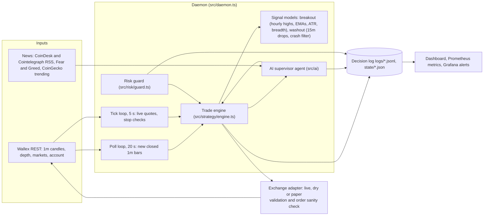
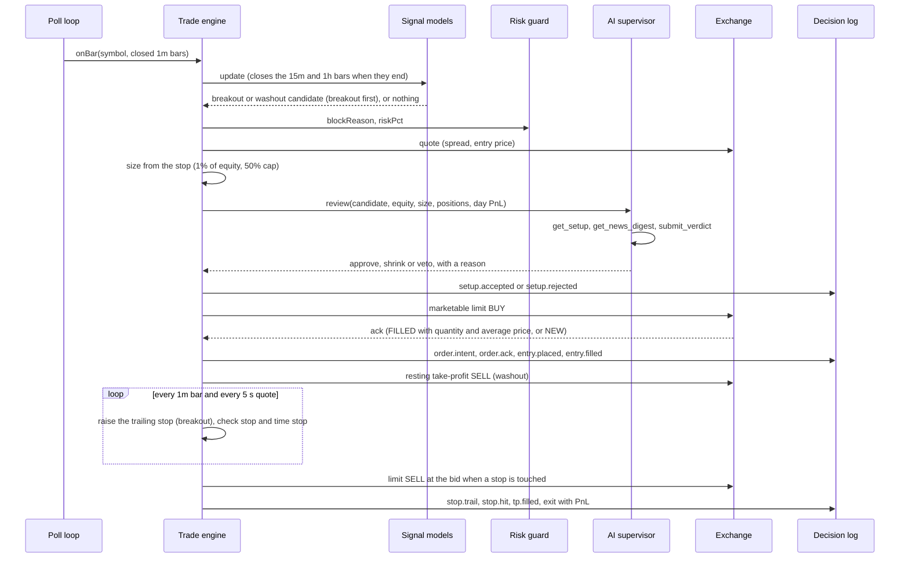
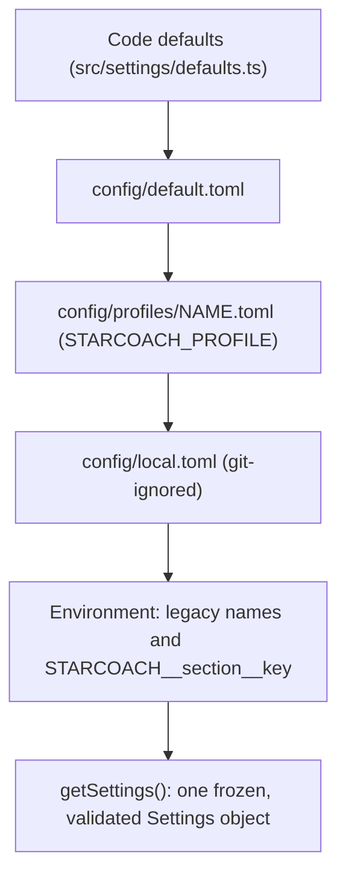

# Architecture

One Bun process, one strategy object, one `Exchange` interface with three adapters (live, dry, paper). The strategy code is identical in backtest, shadow, dry and live, so what was tested is exactly what trades.

## Components

## One decision, in order

## Module map

| Folder / file | Responsibility |
|---|---|
| `src/cli.ts` | Commands `check backtest shadow dry live pullout`, flag parsing, strategy wiring |
| `src/daemon.ts` | Run loop, schedule (entry cutoff, run end), state resume, guarded exchange, degraded alarm, graceful shutdown |
| `src/strategy/engine.ts` | Shared trade engine: one position book, sizing, guard, AI review, entries, take-profits, stops, trailing stops, time stops, persistence, tick stops |
| `src/strategy/breakout/` | Breakout model: `tracker.ts` (incremental hourly bars, indicators, breadth, signal), `index.ts` |
| `src/strategy/washout.ts` | Washout bounce model |
| `src/strategy/index.ts` | `createComboStrategy` (default: breakout + washout) |
| `src/strategy/ict.ts`, `src/ict/` | The alternative ICT model (`--strategy ict`) |
| `src/risk/` | `size.ts`, `guard.ts` (day halt, hard halt, profit locks, kill file, persisted state) |
| `src/ai/` | `supervisor.ts` (libfx agent with three tools), `compat.ts` (provider compatibility), `news.ts` (feeds, sanitisation, caching), `mock.ts`, `try.ts` |
| `src/exchange/` | `live.ts` (fill parsing, order sanity check), `dry.ts`, `paper.ts` (simulator), `validate.ts` (rounding, minimums, allowed markets) |
| `src/wallex/rest.ts` | REST client: TLS only, no redirects, bounded responses, identifier validation, redacted errors |
| `src/security/` | `redact.ts` (secret redaction), `http.ts` (bounded reads, constant-time compare, TLS check) |
| `src/runner/` | `backtest.ts`, `poll.ts` (live data feed with multi-day warm-up), `step.ts` |
| `src/pullout.ts` | Cancel everything and sell all holdings to TMN through TMN markets |
| `src/settings/`, `src/env*.ts` | Typed, layered, validated configuration and environment |
| `src/dashboard/` | Local web dashboard (live, demo and replay modes) |
| `src/telemetry/otel.ts` | Prometheus and OTLP metrics derived from the decision log |
| `arena/` | Strategy tournament harness and the contestants' research code |
| `ops/` | Prometheus, Grafana dashboard (28 panels) and 10 alert rules |

## Modes

| Mode | Command | Candles | Fills | Adapter | Orders sent |
|---|---|---|---|---|---|
| Backtest | `bun run backtest` | Cached history | Simulated with fees, spread and slippage | `PaperExchange` | none |
| Shadow | `bun run shadow` | Live, 20 s poll | Simulated, virtual 5M TMN | `PaperExchange` | none |
| Dry | `bun run dry` or `live --dry` | Live | None. Orders validated and logged as `dry.would_send` | `DryExchange` | none |
| Paper daemon | `bun run live --paper` | Live | Simulated, with the full daemon | `PaperExchange` | none |
| Live | `bun run live --confirm-live` | Live | Real | `LiveExchange` | real |
| Pullout | `bun run pullout [--yes]` | none | Real marketable limit sells | `LiveExchange` | with `--yes` only |

All live-data modes preload 8 days of 1-minute candles (`strategy.breakout.warmupDays`), one UTC day per request, cached on disk.

## Files written at run time

| Path | Content |
|---|---|
| `logs/<command>-<ISO time>.jsonl` | Decision log (`backtest-`, `shadow-`, `dry-`, `pullout-`; the daemon writes `live-` in every mode). One JSON object per line with `ts`, `sha` (git commit), `event` and data. Owner-only, redacted |
| `state/<mode>-run.json` | `runEnd`, `startEquity`, `startedAt`, `sha` |
| `state/<mode>-guard.json` | Equity, day peak, halts, loss count |
| `state/<mode>-strategy.json` | Open positions and pending entries with their stops |
| `data/candles/<SYMBOL>/<day>.json` | Cached complete UTC days of 1m candles |
| `STOP` | Kill switch. Its existence blocks new entries |

Key events: `daemon.start`, `daemon.heartbeat`, `strategy.primed`, `setup.accepted`, `setup.rejected`, `ai.verdict`, `order.intent`, `order.ack`, `exchange.place`, `entry.placed`, `entry.filled`, `tp.placed`, `stop.trail`, `stop.hit`, `tp.filled`, `exit`, `pullout.*`, `daemon.stop`. Safety events: `entry.uncertain` and `entry.unconfirmed` (an order reply was lost or a fill is not yet visible in the balance; the trade is reconciled instead of dropped), `exit.unsellable` (a remainder below the market minimum), `order.cancel_failed`, `order.open_orders_failed`, `state.restore_skipped` and `daemon.restore_incomplete` (a saved position could not be restored, with a console warning).

## Failure handling and restart

| Situation | Behaviour |
|---|---|
| Candle request fails | Logged as `daemon.api_error`; the poll interval backs off (20 s doubling, at most 60 s) |
| Quote request fails for one market | That market backs off (5 s doubling, at most 60 s); the others continue |
| Strategy throws | Caught and logged as `daemon.strategy_error`; the loop continues |
| Exchange unreachable for 5 minutes with positions open | `daemon.degraded` event and a console alarm every 60 s |
| AI slow or down | A fallback verdict after `AI_TIMEOUT_MS` (12 s); the reason is logged |
| Provider quirks | `src/ai/compat.ts` adapts reasoning-model and content-filter differences automatically |
| SIGINT or SIGTERM | Stop entries, cancel pending buys, save state, report. A second signal exits at once |
| Restart with the same `RUN_END` | Guard history, open positions and their stops are restored |
| Restart with a different `RUN_END` | Open positions and pending entries are kept and restored; a flat state starts fresh |
| `RUN_END` reached | Pending buys are cancelled and the daemon exits; holdings are converted with `bun run pullout --yes` |

## Configuration

`bun run config show` prints every effective value with the layer it came from, `bun run config validate` checks the environment and every profile, and `bun run config hash` prints the hash that is also written to the log at start.

## Docker

One image runs the daemon (`docker/entrypoint.sh` validates environment and config, prints the config hash, requires live confirmation, then starts `bun src/cli.ts live`) and, with another command, the dashboard or `pullout`. Compose runs both services hardened (non-root, read-only root filesystem, no capabilities, no new privileges, resource limits) and publishes ports on `127.0.0.1` only. See [SECURITY.md](SECURITY.md) and [OPERATIONS.md](OPERATIONS.md).
