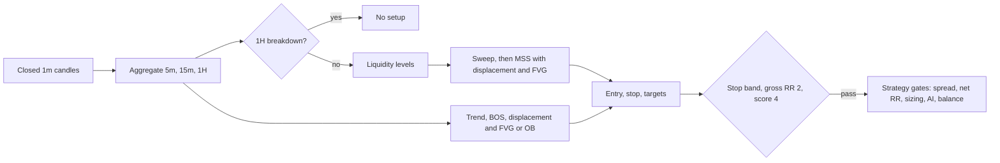

# The ICT model (alternative strategy, historical)

> **Historical document.** The ICT model was the bot's first strategy. It lost the strategy tournament ([RESEARCH.md](RESEARCH.md)) and is no longer the default: the bot runs `combo` (trend breakout + washout bounce, [STRATEGY.md](STRATEGY.md)). The ICT model still ships and runs with `--strategy ict`; this page documents it for reference.

Everything below is what `src/ict/detect.ts`, `src/ict/primitives.ts` and `src/strategy/ict.ts` do today. Default numbers come from `[detect]` and `[strategy.ict]` in `config/default.toml`. [ict-strategy.md](../ict-strategy.md) is the wider specification. The code implements a subset: **long only, spot, models A (sweep) and E (continuation)**. Unicorn, Silver Bullet and Turtle Soup are not implemented.

## 1. Data and timeframes

| Item | Value |
|---|---|
| Source | Wallex `udf/history`, resolution 1 minute |
| Detector input | At most the last 4000 closed 1m bars, minimum 300 |
| Aggregation | 5m (600 bars max), 15m (400), 1H (200). Built from 1m. The still-forming bucket is dropped |
| Scan timeframes | 5m and 15m (legs of at most 12 and 8 bars between sweep and MSS) |
| Bias and levels | 1H and 15m. Previous-day and 8-hour block levels are built from 1H bars |
| Cadence | Detector runs on every new closed 1m bar of each symbol |

There is no 4H aggregation in the code.

## 2. Building blocks

| Term | Implementation |
|---|---|
| Swing | `swingN = 1`: high above the bar before and not below the bar after (same for lows). Known only after `N` more bars close |
| ATR | 14-bar average true range, floored at 0.1% of price |
| Sell-side levels (sweep candidates) | Rank 0: 15m swing lows (n=1) and 5m swing lows (n=2). Rank 1: 15m swing lows (n=2), 1H swing lows, 8h block low. Rank 2: equal lows (within max of 0.1% of price and 0.15 ATR), previous-day low. Each level carries the time it became known |
| Buy-side levels (targets) | Same construction on highs: swing highs, equal highs, previous-day high, 8h block high |
| Sweep | A bar with `low <= level * (1 - 0.0002)` and `close > level`, on a level not traded below since it was known. Highest rank wins |
| Displacement | One or two same-colour candles: body at least 1.5 ATR, at least 60% of their range, leaving a bullish FVG |
| FVG | Bullish only: `low[c3] > high[c1]`, size at least 0.15 ATR. CE is its midpoint |
| MSS | A bar closes (not wicks) above the last confirmed swing high, within 24 bars before the sweep |
| Dealing range | Lowest low to highest high from the sweep bar to the end of the leg. Longs need entry in the lower half and below the last close |
| OTE | 62% to 79% retracement of the dealing range |
| 1H bias | `breakdown`: last 1H close below the last confirmed 1H swing low with a bearish displacement, then no trading at all. `bullish`: last 1H close above the mean of the last 8 closes. Else `neutral` |

## 3. Model A: sweep, MSS, FVG

1. A bar sweeps a fresh sell-side level and closes back above it.
2. Within the leg limit a later bar closes above the last swing high **and** is a displacement. If a bar closes at or below the swept level first, the attempt is dropped.
3. For each FVG left by the displacement, choose the entry: CE if it lies inside the OTE zone, else the middle of the FVG/OTE overlap, else CE (no OTE bonus). Tried in that order.
4. **Stop** = dealing-range low minus 0.05 ATR. Must be 1.0% to 2.5% below entry.
5. **Targets**: buy-side pools above entry, skipping any already traded through. TP1 is the first pool at least 2R (gross) away. TP2 is the next pool above TP1 by more than 0.2%. The range high also counts as a pool.
6. Reject if price already traded to the stop, or retraced into the entry zone and closed below the FVG low (1m closes, `freshnessUseClose`).

## 4. Model E: continuation after BOS

Needs a 15m uptrend (last two confirmed swing highs and lows both rising). A bar closes above the last swing high for the first time (break of structure, at most 60 bars back) with displacement, at most 16 bars ago. The range runs from the last swing low before the impulse to the end of the leg. Entry zone is the FVG or an order block (last bearish candle within 3 bars before the displacement). Stop sits under the candle before the FVG (or the order block low), lowered to the pullback low if price already dipped below entry, minus 0.05 ATR. Same band, targets and scoring. The log shows `sweep.kind = impulse-low`.

## 5. Score (minimum 4 of 9)

| Part | Points | Condition |
|---|---|---|
| bias | 0 or 1 | 1H bullish |
| level | 0, 1, 2 | Rank of the swept level (continuation: 0) |
| session | 0 or 1 | Displacement bar between 07:00 and 21:00 UTC |
| displacement | 0 or 1 | Displacement at least 2 ATR |
| fvgOte | 0 or 2 | Entry inside OTE (`ce` or `overlap`) |
| deepDiscount | 0 or 1 | Entry in the lowest 30% of the range |
| rr3 | 0 or 1 | Gross RR at least 3 |

Within a timeframe the best candidate is the highest score, then the later MSS. Across timeframes the higher score wins and 5m is scanned first.

## 6. Gates before an order

The detector only runs for a symbol with no position or pending entry, entries enabled, and fewer than 2 open positions plus pending entries in total. A candidate then passes, in order:

| # | Gate | Default |
|---|---|---|
| 1 | Not already traded (setup key) and guard not blocking (`STOP` file, halts) | see RISK.md |
| 2 | Spread `(ask - bid) / bid` | at most 1% |
| 3 | Levels valid (`0 < stop < entry < tp1`) | |
| 4 | **Net RR** | at least 1.5 |
| 5 | Sizing (min notional, step size) | see RISK.md |
| 6 | AI supervisor | veto or shrink only |
| 7 | Free TMN covers `qty * entry * (1 + maker)` | |

Net RR = `win / loss`, with `win = (tp1 - entry)/entry - 2 * maker` and `loss = (entry - stop)/entry + maker + taker + slippage` (maker 0.25%, taker 0.3%, slippage 0.1%). Every rejection is logged once as `setup.rejected` with the reason.

## 7. Entry and exits

| Step | Rule |
|---|---|
| Entry | Limit BUY at the entry price. Expires 180 minutes after detection, cancelled if a 1m bar closes below the stop, or if entries are disabled or the guard blocks |
| After fill | TP1 limit SELL for 50%, TP2 limit SELL for the rest (TP2 = TP1 if no second pool). If a leg is under the market minimum, everything goes to TP1 |
| After TP1 | Stop moves to `entry * 1.006` (covers round-trip fees), checked from the next bar |
| Stop | **Watched by code**, not an exchange order: a closed 1m bar with `low <= stop`, or live bid `<= stop` (5 s ticks) |
| Stop exit | Cancel TPs, limit SELL at `bid * (1 - 0.5%)`. Each retry widens the discount by 0.5% steps, capped at 12% |
| Time stop | 240 1m bars after the fill and last close below entry |
| End of run | Entries off 45 min before `RUN_END`. Selling to TMN is done with `bun run pullout --yes` |
| Duplicates | A setup key (`symbol:sweep time:FVG time`) trades once. The last 500 keys are persisted |

## 8. No-lookahead guarantees

- The detector gets closed 1m candles only. Aggregated buckets that have not finished are dropped.
- A swing, an equal-low pair or a block level is only used after its `known` time (swing bar plus `N` closed bars).
- Sweeps need a level that was already known at the sweep bar. Targets already traded through since they were known are skipped.
- Tests `no lookahead: result at k never depends on bars after k` and the continuation equivalent append bars and compare results (`test/ict.detect.test.ts`).
- Backtest: an order placed on bar `i` can fill only from bar `i+1`, and only if price trades through the limit by one tick.

## 9. Worked example (fictional TMN market, 15m, equity 5,000,000 TMN)

| Step | Value |
|---|---|
| Swept level | 15m swing low 39,500 (rank 1). Bar low 39,300, close 39,620. Depth passes (`39,300 <= 39,492`) |
| MSS | Last swing high 40,300. Displacement bar closes 40,700, body 1,060, ATR 400, so 2.65 ATR, body 94% of range |
| FVG | Sweep bar high 39,900, next-but-one low 40,100. Gap 39,900 to 40,100, CE 40,000 |
| Range | Low 39,300, high 41,300, size 2,000. OTE 39,720 to 40,060. CE 40,000 is inside, kind `ce`. Position in range 35%, discount |
| Entry / stop | 40,000. ATR at displacement 420, stop `39,300 - 21 = 39,279`. Risk 721, 1.80% of entry, inside 1% to 2.5% |
| Targets | Minimum TP at 2R = 41,442. TP1 = 15m swing high 42,300 (gross RR 3.19). TP2 = previous-day high 43,100 |
| Score | bias 1 + level 1 + session 1 + displacement 1 + fvgOte 2 + deepDiscount 0 + rr3 1 = **7** |
| Spread | Bid 40,950, ask 41,000: 0.12% |
| Net RR | win = 5.75% - 0.5% = 5.25%. loss = 1.8025% + 0.25% + 0.3% + 0.1% = 2.4525%. Net RR **2.14** |
| Size | `s = 0.018025`, cost = 0.024471, N = 50,000 / 0.024471 = 2,043,224 TMN (40.9% of equity, under the 50% cap). Qty 51.08, value 2,043,200 |
| AI | Approve (or resize to 0.5: qty 25.54) |
| Orders | BUY 51.08 @ 40,000. After fill: SELL 25.54 @ 42,300 and SELL 25.54 @ 43,100 |

| Outcome | Net result (fees included) |
|---|---|
| Stop hit at 39,279 | -47,956 TMN, -0.96% of equity (sizing budget also covers 0.1% slippage, so up to -1.00%) |
| TP1, then break-even stop at 40,240 | +53,980 TMN, +1.08% |
| TP1 and TP2 | +127,355 TMN, +2.55% |

Fees: 0.25% maker on entry and TP legs, 0.3% taker on stop exits, as in `src/config.ts`.
