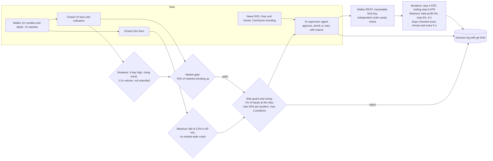
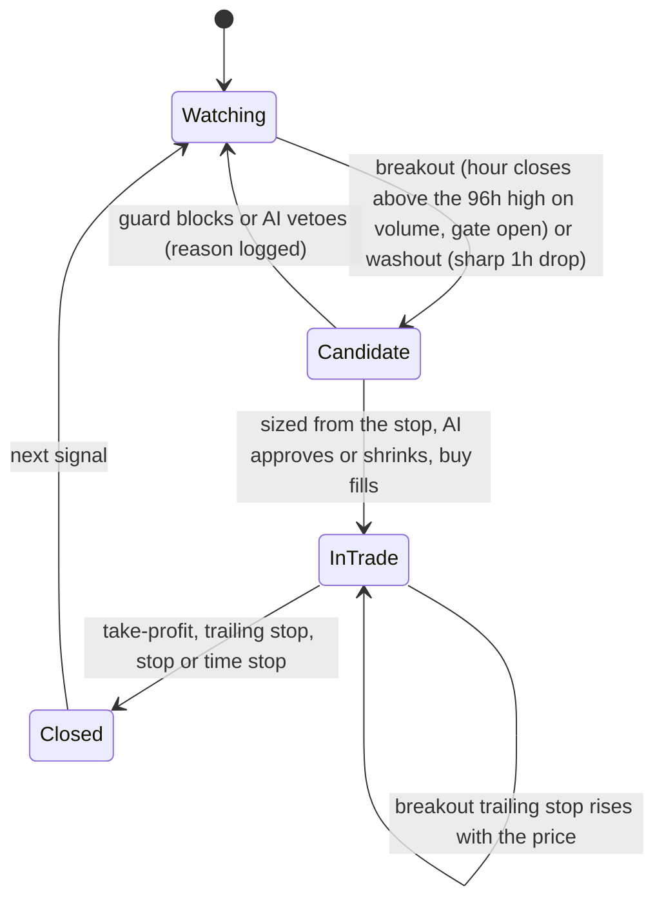

# StarCoach Trader: overview (one page)

An autonomous trading engine for **Wallex spot TMN markets**. It trades two researched models in one position book, a **trend breakout with a market-breadth gate** and a **washout bounce**, sizes every trade from its stop, lets an **agentic AI supervisor** approve, shrink or veto each trade using live news and sentiment, logs the reason for every decision, and converts the account back to **TMN** at the end with one command (`bun run pullout --yes`).

## 1. How it works

## 2. Life of one trade

## 3. Key numbers

| Rule | Value |
|---|---|
| Markets | 15 liquid allowed TMN pairs, spot, long only |
| Breakout signal | 1h close above the 96h high, above a rising 96h EMA, volume at least 1.5x, at most 3 ATR extended |
| Washout signal | Fall of 3.5% or more in 60 minutes on closed 15m bars, while at most half the market is falling; take-profit 4%, stop 6%, time stop 8 h |
| Market gate | At least 70% of the 15 markets above their 168h EMA |
| Risk per trade | 1% of equity at the stop, fees and slippage included |
| Position cap | 50% of equity per position, at most 2 positions |
| Breakout exits | Initial stop 4 ATR, trailing stop 8 ATR, time stop 336 h |
| Account limits | Day halt at 12% below the day's peak, hard halt at 30% below start, profit locks after +15% and +30%, `STOP` kill switch |
| Order safety | Allowed markets only, exchange rounding and minimums, live sanity check (max 3,000,000 TMN per buy, at most 3% above the ask) |
| AI | Reviews every candidate with news and sentiment; can approve, shrink or veto; cannot place or enlarge orders |

## 4. Results

| Test | Return | Max drawdown | Notes |
|---|---|---|---|
| Production backtest, 180 days | +41.43% | 6.15% | 255 round trips, 58.8% wins, about 4 per 3 days |
| Production backtest, last 60 days | +26.79% | 7.82% | 75 round trips |
| Tournament harness, held-out 60 days (3x harsher spread) | +17.52% | 7.85% | Never seen during development |
| Tournament harness, 120-day train window | +30.73% | 7.60% | |
| Breakout model alone, held-out 60 days | +23.86% | 7.85% | Tournament winner |

Details: [RESEARCH.md](RESEARCH.md).

## 5. Modes

| Command | Data | Orders |
|---|---|---|
| `bun run backtest` | Cached history | Simulated with fees, spread and slippage |
| `bun run shadow` | Live | Simulated, virtual 5M TMN |
| `bun run dry` | Live | Validated and logged, never sent |
| `bun run live --paper` / `--dry` / `--confirm-live` | Live | Paper / dry / real |
| `bun run pullout` / `--yes` | Live | Plan only / sell everything to TMN |
| `bun run dashboard` (`--demo`, `--replay`) | Logs | None |

## 6. Documentation

| Doc | Content |
|---|---|
| [README](../README.md) | Quick start and highlights |
| [STRATEGY](STRATEGY.md) | Exact buy and sell rules with a worked example |
| [RESEARCH](RESEARCH.md) | Strategy tournament, held-out results, backtests |
| [RISK](RISK.md) | Sizing, guard, order checks, stops, pullout |
| [AI](AI.md) | AI supervisor and AI research agents |
| [WALLEX](WALLEX.md) | Endpoints, verified response shapes, live verification, MCP |
| [ARCHITECTURE](ARCHITECTURE.md) | Components, sequence, modes, failure handling |
| [SECURITY](SECURITY.md) | Threat model, controls, standards alignment |
| [OPERATIONS](OPERATIONS.md) | Runbook, configuration, dashboard, metrics, emergencies |
| [TESTING](TESTING.md) | Tests, backtests, shadow, dry, live verification |
| [COMPLIANCE](COMPLIANCE.md) | Challenge requirements and judging criteria, point by point |
| [VIDEO_SCRIPT_FA](VIDEO_SCRIPT_FA.md) | Persian demo video script |
