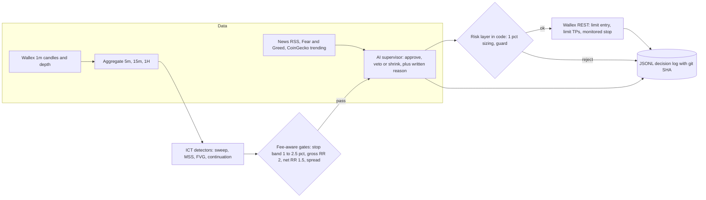
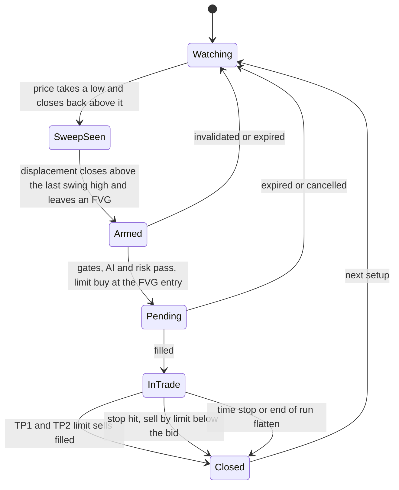

# StarCoach Trader: overview (one page)

A Bun daemon trades a simplified **ICT** strategy (liquidity sweep, structure shift, FVG retracement, plus trend continuation) on **Wallex spot, TMN pairs, long only**. Code makes and places every order. An **AI supervisor** (OpenAI-compatible model, `libfx` agent) can only **approve, veto or shrink** a candidate trade and writes the reason to the decision log. At the end of the run everything is sold back to **TMN**.

## 1. How it works

## 2. Life of one trade

## 3. Key numbers

| Rule | Value |
|---|---|
| Market | Spot only, long only, TMN pairs not in `config/blocked-markets.txt` |
| Risk per trade | 1% of equity lost if the stop is hit, fees and slippage included. Position size follows from the stop, capped at 50% of equity |
| Stop | 1.0% to 2.5% below entry, never widened, watched by the daemon every 5 s |
| Targets | TP1 (50%) at the next liquidity pool at least 2R away, TP2 (rest) at the next one. After TP1 the stop moves to entry plus 0.6% |
| Cost gate | Net RR at least 1.5 after maker 0.25%, taker 0.3%, slippage 0.1% |
| Open positions | At most 2 (pending entries count) |
| Day halt | 12% below the day's peak. Hard kill at 30% below start |
| Profit lock | Risk 0.5% after +15%, 0.25% after +30% |
| Other guards | 3 losses in a row pause 30 min, 6 entries per hour, `STOP` file |
| End of run | Entries off 45 min before `RUN_END`, flatten from 15 min before, all coins sold to TMN |

## 4. Modes

| Command | Data | Orders |
|---|---|---|
| `bun run backtest --strategy ict --symbols auto --days 7` | Cached 1m history | Paper fills with fees |
| `bun run shadow --strategy ict --minutes 1440` | Live | Paper fills, virtual 5M TMN |
| `bun run dry --strategy ict` | Live | Validated and logged, never sent |
| `bun run live --paper` / `--dry` / (no flag) | Live | Paper / dry / real orders |
| `bun run pullout` and `bun run pullout --yes` | Live | Plan only / cancel all and sell everything to TMN |
| `bun run check` | Live | None. Prints raw private API responses |

`backtest`, `shadow`, `dry` and `live` default to the `ict` strategy. `--strategy noop` places no orders.

## 5. Honest status

- Built and unit tested: detectors, strategy, sizing, guard, AI supervisor (fake server), daemon, paper, dry, pullout, walk-forward, dashboard, metrics.
- 7-day backtest on 12 markets: +1.14%, max drawdown 1.12%, two closed round trips. The walk-forward pick had 0 test trades. These are tiny samples, not evidence of an edge. The fee floor keeps trade count low.
- **Not verified yet:** private Wallex response shapes and order parameters (run `bun run check` with the real key), the challenge credit account's balance endpoint, a real LLM endpoint, real fills, a 24 h live run.

## 6. Documentation

| Doc | Content |
|---|---|
| [README](../README.md) | Quick start and feature list |
| [ARCHITECTURE](ARCHITECTURE.md) | Components, sequence, modes, state files, failure handling |
| [STRATEGY](STRATEGY.md) | The exact algorithm with a worked example |
| [RISK](RISK.md) | Sizing, guard, flatten, pullout |
| [AI](AI.md) | Supervisor, tools, news, fail mode |
| [OPERATIONS](OPERATIONS.md) | Runbook, env vars, dashboard, metrics, emergencies |
| [TESTING](TESTING.md) | Reproducing every test mode, simulator assumptions |
| [COMPLIANCE](COMPLIANCE.md) | Challenge requirements and judging criteria mapping |
| [RESEARCH](RESEARCH.md) | Generated walk-forward table |
| [VIDEO_SCRIPT_FA](VIDEO_SCRIPT_FA.md) | Persian demo video script |
