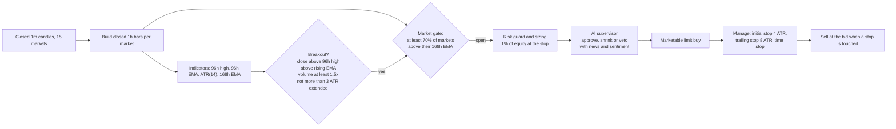

# Strategy: breakout + washout ("combo")

The bot runs two complementary signal models in **one position book** (`src/strategy/engine.ts`): a **trend breakout** that rides multi-day moves, and a **washout bounce** that buys sharp, market-specific overshoots and sells the rebound within hours. Breakouts make the big wins; washouts keep the bot trading regularly (about four round trips per three days in the backtests). Both share the same sizing, risk guard, AI review, stops and decision log, and at most 2 positions are open at once. Every number below is a setting in `config/default.toml` (`[strategy.breakout]`, `[strategy.washout]`), so a run can be reproduced and audited from its config hash.

| | Breakout | Washout |
|---|---|---|
| Idea | Ride a new multi-day uptrend | Buy an overshoot, sell the rebound |
| Signal | 1h close above the 96h high on 1.5x volume, rising trend, 70% of markets up | Price fell 3.5% or more in 60 minutes (closed 15m bars) while at most half the market is falling |
| Exit | Initial stop 4 ATR, trailing stop 8 ATR, time stop 14 days | Take-profit 4% above, stop 6% below, time stop 8 hours |
| Typical hold | Days | Hours |
| Priority | First on every bar | When no breakout fires |

The rest of this page details the breakout model; the washout model is in section 8.

## The idea in one paragraph

Crypto moves in trends, and the strongest trends start when a coin breaks out of a multi-day range on rising volume while the whole market is rising with it. The bot waits for exactly that moment, buys with a stop that gives the trade room to breathe, and then lets the winner run with a trailing stop that only ever moves up. Losers are cut at a fixed, pre-sized loss of about 1% of equity; winners are held for days. In the 180-day backtest of the breakout model alone the average winner was **3.5 times** the average loser, which is where the edge comes from.



## 1. Data

| Item | Value |
|---|---|
| Source | Wallex `/v1/udf/history`, 1-minute candles, closed bars only |
| Markets | 15 liquid, allowed TMN pairs: PEPE, PUMP, USOON, BNB, ETH, XRP, ARB, DOGE, ADA, S, SOL, APE, TRX, LTC, AAVE |
| Signal timeframe | 1 hour, built incrementally from 1m bars. The still-forming hour is never used |
| Warm-up | 8 days of 1m history loaded at start (`warmupDays`), so the bot can trade from its first hour |
| Cadence | The signal is evaluated once per market per hour, on the first minute after the hour closes. Stops are checked on every 1m bar and on every 5-second live quote |

## 2. Entry rules (all must hold)

| # | Rule | Setting | Why |
|---|---|---|---|
| 1 | The closed 1h bar closes above the highest high of the previous 96 hours | `lookbackHours = 96` | A 4-day high is a meaningful level that many traders watch |
| 2 | The close is above the 96h EMA and the EMA is rising | `emaHours = 96` | Only trade breakouts that agree with the coin's own trend |
| 3 | The breakout hour's volume is above 1.5x the average of the previous 24 hours | `volumeMult = 1.5` | Real breakouts come with participation; quiet ones fail |
| 4 | The close is at most 3 ATR above the broken level | `maxChaseAtr = 3` | Never chase a candle that has already run |
| 5 | At least 70% of the 15 markets close above their own 168h EMA | `breadthMin = 0.7`, `breadthEmaHours = 168` | Breakouts work when the tide is rising. When the market is weak, the bot stays in TMN |
| 6 | Fewer than 2 positions are open, the risk guard allows entries, the spread is under 2% | `risk.maxPositions = 2` | Capital and loss limits come first |
| 7 | The AI supervisor approves (or shrinks) the trade after reading the setup, the news and the market mood | `[ai]` | Catches what price data cannot see: hacks, delistings, unlocks, euphoria |

## 3. Position size

The stop decides the size, so every trade risks the same share of the account:

```
riskBudget   = equity x riskPct                       (1%, lower after profit locks)
lossPerUnit  = (entry - stop) + entry x taker + stop x taker + entry x slippage
quantity     = min( riskBudget / lossPerUnit , 50% of equity / price , free TMN / price )
```

A stop-out therefore costs about 1% of equity including fees and slippage, and no position can ever exceed 50% of the account, so the bot never enters with all its money. The AI supervisor can only make a position smaller.

## 4. Exit rules

| Exit | Rule | Setting |
|---|---|---|
| Initial stop | 4 ATR(14, 1h) below the signal close (the breakout hour's close, or the latest 1m close if lower) | `stopAtr = 4` |
| Trailing stop | Highest high since entry minus 8 ATR. It only moves up and is logged each time it rises | `trailAtr = 8` |
| Time stop | Sell after 336 hours in a position | `maxHoldHours = 336` |
| Execution | A marketable limit sell at the bid. If it does not fill, the limit is lowered by 0.5% per retry, up to 12% | `stopExitSlip`, `stopExitSlipMax` |

Most profit comes from the trailing stop: in the 180-day backtest 27 of the 36 breakout trades closed on it (in the combo and with the breakout model alone). Breakout trades were held for 106 hours on average when the model ran alone.

## 5. Worked example (illustrative numbers)

| Step | Value |
|---|---|
| Market state | 12 of 15 markets above their 168h EMA (80%). The gate is open |
| Breakout | ARBTMN closes the hour at 41,230. The 96h high was 40,900. Hour volume 1.8x the 24h average. 96h EMA 39,800 and rising. ATR 420. Extension 330 = 0.8 ATR |
| Entry | Ask 41,260. Marketable limit at 41,342 (ask + 0.2%) |
| Stop | 41,230 - 4 x 420 = 39,550 (4.1% below entry) |
| Size | Equity 5,000,000. Budget 50,000. Loss per unit 41,260 - 39,550 + 124 + 119 + 41 = 1,994. Quantity 25.07 ARB, value 1,034,000 TMN (21% of equity) |
| AI | Reads Fear & Greed 58, no adverse ARB headline, 21% of equity, day PnL 0. Approves |
| Trail | Price runs to 46,100. Trail = 46,100 - 8 x 450 = 42,500, now above the entry, so the trade can no longer lose |
| Exit | Price falls back to 42,500. Sold at the bid. Net of fees about +2.4% on the position, +0.5% of equity |

## 6. Why it works and when it rests

- **The market gate** is the key ingredient. In the research window the same breakouts without the gate lost money, because breakouts in a falling market are traps. With the gate the bot sits in TMN through weak markets and only spends its risk when most coins trend up.
- **Asymmetric exits.** Small fixed losses, large open-ended wins. Run alone over 180 days, the breakout model won 52.8% of its trades with a 3.5:1 payoff, a strong edge after fees.
- **Few parameters, chosen on a plateau.** Every setting was tested with its neighbours (lookback 72 to 120 hours, stop 3 to 5 ATR, volume 1.0 to 2.0x, gate 0.6 to 0.8) and all neighbours were profitable on the training data. See [RESEARCH.md](RESEARCH.md).

## 7. No lookahead

- Only closed 1m bars reach the strategy; the forming hour is never used for a signal.
- Every indicator (EMA, ATR, highs, volume average, breadth) updates incrementally when an hour closes, from past data only.
- In backtests an order placed on bar *i* can only fill from bar *i+1*, and a limit buy fills only if price trades through it by one tick.
- The production module reproduces the research version trade for trade (same 23 and 17 trades, same win rates). See [RESEARCH.md](RESEARCH.md).

## 8. The washout model (`src/strategy/washout.ts`)

Thin altcoin markets overshoot on fast drops and partly retrace within hours. In the research data the average rebound over the next four hours grew with the size of the preceding one-hour drop (about +1.2% after a 3% drop, +2.1% after a 5% drop, before costs).

| # | Rule | Setting |
|---|---|---|
| 1 | On the close of a 15m bar, the price is at least 3.5% below its level 60 minutes earlier | `signalMinutes = 15`, `lookbackMinutes = 60`, `dropPct = 0.035` |
| 2 | At most 50% of the markets fell more than 2% over the same hour (a market-wide crash is not an overshoot) | `crashDropPct = 0.02`, `crashBreadthMax = 0.5` |
| 3 | No position in that market, a free slot, the guard allows entries, the AI approves | shared with breakout |
| Entry | Marketable limit at the ask + 0.2%, as for breakouts | `strategy.breakout.entrySlip` (shared) |
| Take-profit | Resting limit sell 4% above the signal close (maker fee) | `takeProfitPct = 0.04` |
| Stop | 6% below the signal close, checked every minute and every 5 s | `stopPct = 0.06` |
| Time stop | 8 hours | `maxHoldMinutes = 480` |
| Size | 1% of equity at the stop (about 15% of equity per position) | `riskMult = 1` |

In the 180-day backtest the washout model made 219 of the 255 round trips with a 60.3% win rate, while the breakout model made 36 trades that carried most of the profit.

## 9. The ICT model

The bot also ships the ICT model (liquidity sweep, market structure shift, fair value gap) used in the first version: `--strategy ict` or `strategy.active = "ict"`. It competed in the strategy tournament and the combo strategy replaced it as the default. `--strategy breakout` runs the breakout model alone. Its rules are in [ICT_MODEL.md](ICT_MODEL.md).
